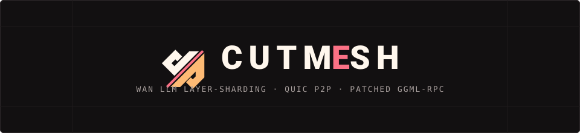
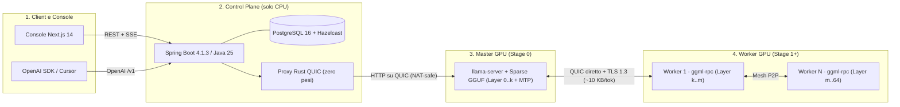
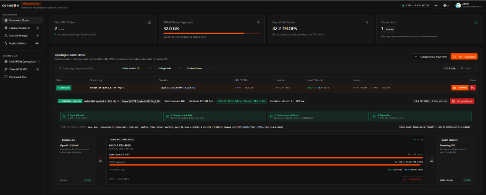

<p align="center">
  
</p>

# Cutmesh

> **Lingua:** [English](./README.md) · **Italiano**

**Cutmesh** è una piattaforma open-source di inferenza LLM distribuita che permette di **unire GPU eterogenee — anche direttamente da casa su normali connessioni Internet** — per eseguire modelli open-weight di grandi dimensioni (`27B–74B+`) ed esporli tramite un'unica **API compatibile OpenAI** e una **Console Web**.

### Cos'è e cosa puoi farci (anche da casa)

- **Funziona da casa, dietro normali router:** ogni GPU si collega con un singolo comando `docker run` su Linux o Windows (WSL2). Il **QUIC P2P con UDP hole-punching** e il supporto automatico UPnP/NAT-PMP creano tunnel cifrati diretti tra le schede senza bisogno di datacenter, InfiniBand, NVLink o VPN configurate a mano.
- **Unisci le GPU che hai già:** combina schede da 8 GB, 12 GB, 16 GB o 24 GB+ tra il tuo PC di casa, la workstation di un amico o una VM in cloud. Cutmesh divide automaticamente i layer del modello sulla VRAM disponibile e li gestisce come un unico **Rig** di inferenza.
- **API OpenAI pronta all'uso & Console Web:** appena il Rig è operativo puoi collegare qualsiasi client compatibile OpenAI (SDK Python, assistenti IDE, Open WebUI o la **Playground Chat** integrata) su `/v1/chat/completions` con streaming SSE in tempo reale.
- **Auto-Pilot e self-healing automatici:** nessun calcolo manuale dei layer. Cutmesh legge la VRAM reale, sceglie i punti di taglio validi, elegge la scheda migliore come Master (Stage 0) e riconfigura il cluster in automatico se un PC di casa si spegne o cade la linea.
- **Ricerca sulla privacy delle attivazioni:** un livello sperimentale di trasformazione covariante permette di studiare come nascondere prompt, risposte e attivazioni intermedie ai nodi remoti non fidati.

Il resto di questo documento entra nel dettaglio di **come è costruito il sistema**: i quattro livelli, lo stack, i protocolli, gli adattamenti al motore di inferenza, le regole di taglio, la scalabilità orizzontale e i limiti reali — spiegati su un modello di riferimento (`Qwen 3.8 27B`), con altri modelli nella sezione finale.

---

## Indice

1. [Il problema](#1-il-problema)
2. [Il modello di riferimento: Qwen 3.8 27B](#2-il-modello-di-riferimento-qwen-38-27b)
3. [L'architettura: i quattro livelli](#3-larchitettura-i-quattro-livelli)
4. [Strumenti e tecnologie](#4-strumenti-e-tecnologie)
5. [I protocolli](#5-i-protocolli)
6. [Adattamenti al motore di inferenza (specifici e sperimentali)](#6-adattamenti-al-motore-di-inferenza-specifici-e-sperimentali)
7. [Come si decide il taglio](#7-come-si-decide-il-taglio)
8. [Rete, NAT e resilienza](#8-rete-nat-e-resilienza)
9. [Caso di studio chiave: Sicurezza di decodifica e degli stati intermedi](#9-caso-di-studio-chiave-sicurezza-di-decodifica-e-degli-stati-intermedi)
10. [Comportamento del sistema](#10-comportamento-del-sistema)
11. [Dove sono stati fatti i test e cosa hanno mostrato](#11-dove-sono-stati-fatti-i-test-e-cosa-hanno-mostrato)
12. [Quick Start](#12-quick-start)

---

## 1. Il problema

### Perché una sola GPU spesso non basta

Il motivo più evidente per distribuire un LLM è che **i pesi del modello superano la VRAM di una singola scheda** — ad esempio far girare un modello da 27B su schede consumer da 8–16 GB, oppure modelli da 70B+ su più schede workstation.

Anche quando i soli pesi entrano in una GPU, **la memoria a runtime cresce dinamicamente**: finestre di contesto lunghe (KV cache), encoder multimodali, teste speculative/MTP e richieste concorrenti saturano rapidamente la VRAM residua.

Ci sono quindi due motivi generali per distribuire l'inferenza su GPU eterogenee: **pesi che non entrano su una sola scheda** e **memoria di contesto/runtime che cresce con l'uso**. La stessa pipeline Cutmesh gestisce entrambi i casi — cambia solo la policy di taglio per modello.

### Il secondo problema: la riservatezza dei dati sulla GPU remota

Quando il calcolo viene distribuito su schede esterne, c'è un aspetto fondamentale: **per elaborare una risposta, la GPU remota riceve e manipola gli stati intermedi del modello direttamente nella propria memoria**.

Chi ha provato a distribuire i modelli su più computer si è spesso affidato a una convinzione intuitiva ma errata:
*«Alla scheda grafica remota non inviamo le parole scritte dall'utente, ma solo una serie di numeri (i vettori degli strati intermedi), quindi chi ospita quella scheda non può sapere cosa stiamo chiedendo.»*

La ricerca ha mostrato che questa convinzione **è falsa**, su due piani diversi:

1. **Sul percorso di rete**: nei sistemi RPC tradizionali i tensori viaggiano su connessioni non cifrate, esposte a chiunque si trovi in mezzo.
2. **Dentro la GPU remota**: anche proteggendo il canale di rete con un tunnel cifrato, chi possiede la scheda vede comunque gli stati intermedi nella propria memoria. **Logit-Lens** (*nostalgebraist*, 2020) e la **Tuned Lens** (Belrose et al., 2023) hanno mostrato che i vettori degli strati intermedi sono già parzialmente allineati con lo spazio del vocabolario finale: moltiplicandoli per la tabella pubblica delle parole del modello si possono ricostruire con buona approssimazione singoli token. Gli stessi autori di **Petals** lo segnalavano nella loro documentazione.

La crittografia omomorfica applicata a ogni token non è stata provata in questo sistema; la strada seguita, descritta nella [sezione 9](#9-la-protezione-del-testo), si limita ad applicare quanto proposto dagli studi sull'invarianza computazionale e sull'offuscazione covariante (*SliceGPT*, *QuaRot*, *AloePri*, *ConjFormer*): la validità matematica e l'efficacia di queste trasformazioni sono interamente a carico della letteratura scientifica citata.

### Le domande da cui sono partito

Non sono partito da una soluzione, ma da cinque domande:

1. **Il modello può essere diviso?** Non «in quanti pezzi», ma proprio se un modello pensato per girare intero su una macchina possa essere tagliato e continuare a funzionare su macchine diverse.
2. **I prompt e le informazioni possono essere offuscati per non farli leggere?** Proteggere la connessione di rete non basta: chi esegue il calcolo vede i vettori intermedi nella propria memoria.
3. **È possibile farlo in peer-to-peer?** Senza un server centrale che tenga il modello, con nodi che entrano ed escono e con router domestici in mezzo.
4. **Se il modello viene diviso, il taglio deve essere adattato a ogni LLM diverso?** Gli strati non sono tutti uguali e non fanno tutti lo stesso lavoro. La risposta che questo documento dà è **sì**: serve un profilo e un adapter per architettura.
5. **Tutti gli LLM possono essere adattati?** Questa **resta aperta**. Sono stati provati tre modelli diversi, ma questo non dice ancora quali architetture siano compatibili e quali no.

Le prime quattro sono architettura. La quinta resta aperta.

---

## 2. Il modello di riferimento: Qwen 3.8 27B

Il punto che cambia tutto è che **gli strati non sono tutti uguali**. Con i modelli ibridi, dividere «32 strati e 32 strati» non divide la memoria a metà.

| Cosa | Valore |
|---|---|
| Layer del backbone | 64, cioè 16 volte il ciclo **3 Gated DeltaNet + 1 attenzione completa** (`full_attention_interval: 4`) |
| Strati che accumulano KV cache | **16 soltanto** (`blk.3`, `7`, `11` … `63`) |
| Strati a stato fisso | 48 Gated DeltaNet (~1,5 MB per strato in BF16, costante con la lunghezza) |
| KV cache | ~64 KB per token in FP16 → circa **16 GB** a 262.144 token |
| Vettore che passa fra strati | 5.120 numeri = **circa 10 KB** in FP16 |
| Peso degli strati (4 bit) | da ≈172 MB (`blk.14`) a ≈269 MB (`blk.63`): **non costante** |
| Testa MTP in coda | `blk.64`, ~335 MB |
| Vocabolario + classificatore | `token_embd.weight` + `output.weight`, circa 1,68 GB in coppia |

---

## 3. L'architettura: i quattro livelli

Il sistema è separato in quattro livelli. I primi due non eseguono il modello: uno raccoglie le richieste, l'altro decide. Il calcolo sta tutto negli ultimi due, che parlano direttamente fra loro.



| Livello | Ruolo e dettagli chiave |
|---|---|
| **1 · Client e Console** | Console Next.js 14 e qualsiasi client OpenAI-compatible (`POST /v1/chat/completions`, streaming SSE, JWT + API Key Bearer). È l'unico punto di ingresso pubblico. |
| **2 · Control Plane (solo CPU)** | Spring Boot 4.1.3 / Java 25 LTS (7 moduli) + PostgreSQL 16 + Hazelcast 5.3.8. Raccoglie gli heartbeat NVML (VRAM, banda, consumo, temp, RTT), esegue il planner water-filling e inoltra JSON/SSE tramite un proxy Rust HTTP-su-QUIC senza pesi anche se il Master è dietro NAT. Non ha GPU, non ha pesi e non vede tensori. |
| **3 · Master Auto-Eletto (Stage 0)** | Avvia `llama-server` direttamente sulla GPU (`Master-on-GPU`), ospita lo Sparse GGUF, pinna `token_embd.weight` + `output.weight` + `blk.64` (MTP) con `-ot`, esegue i primi layer e chiude il campionamento/streaming. |
| **4 · Worker GPU (Stage 1+)** | Eseguono `ggml-rpc-server` solo su `127.0.0.1` dietro il demone Rust P2P. Scaricano **solo** i propri strati tramite richieste HTTP Range raggruppate nella cache locale FNV-1a. Parlano GPU↔GPU su QUIC v1 diretto + TLS 1.3 (identità Ed25519 + hole-punching UDP, relay escluso dal data plane): **≈10 KB/token in andata**, singolo hop di ritorno per logit e MTP. |

### Concetti chiave: Pool, Rig e ciclo di vita

- **Nodo Worker e Modalità Pool:** ogni GPU collegata entra in `IDLE_STANDBY_POOL` come **`SHARED_POOL`** (abbinabile automaticamente ad altre GPU) oppure **`PRIVATE_SOLO`** (riservata esclusivamente al proprio account).
- **Rig:** un **cluster logico di inferenza** formato da 1 o più GPU bloccate insieme (`LOCKED_IN_RIG`) per servire un'istanza completa di un modello (Stage-0 Master + Worker Stage 1..N). Più Rig indipendenti possono girare in parallelo sullo stesso modello (per aumentare il throughput concorrente) o su modelli diversi.
- **Auto-Pilot vs. Manuale:** i modelli in **`AUTO_PILOT`** (ordinati per priorità `P1`–`P5`) formano e avviano un Rig automaticamente appena nel pool c'è VRAM sana sufficiente; in modalità **`MANUAL_ONLY`** la topologia viene composta manualmente dall'operatore.
- **Macchina a stati del Rig (FSM a 4 fasi):**
  1. `LAYERS_ALLOCATED` — Il planner calcola il taglio dei layer, `--tensor-split`, la finestra di contesto (`-c`) ed elegge lo Stage-0 Master.
  2. `PREWARMING_SHARDS` — Ogni Worker scarica solo i propri intervalli di byte GGUF nella cache locale FNV-1a.
  3. `LOADING_VRAM` — Il Master avvia `llama-server` (`Master-on-GPU`) e mappa i tensori tra Stage 0 e i peer `ggml-rpc` remoti.
  4. `OPERATIONAL (200 OK)` — Il Rig entra nel pool del gateway OpenAI `/v1` con instradamento sticky sulla KV cache (`conversation_id`).

### Auto-elezione del Nodo Master (Stage 0)

Nessuna GPU viene configurata a mano come Master. Ogni volta che un Rig viene formato (o ripristinato dopo una disconnessione), l'orchestratore **elegge automaticamente il nodo Stage-0 Master** tra le GPU disponibili valutando:
- **Margine VRAM per lo Stage 0** (deve ospitare `token_embd`, `output`, `blk.64` MTP più i primi layer del backbone),
- **Banda di memoria e capacità di calcolo** (per ridurre al minimo la latenza di campionamento e MTP),
- **Vicinanza di rete (RTT)** rispetto agli altri worker del Rig.

Se il Master eletto si disconnette, il Control Plane promuove automaticamente una GPU sana superstite come nuovo Stage-0 Master e riapre il tunnel HTTP-su-QUIC, mantenendo la VPS sempre a zero pesi e zero carico di inferenza.

| Livello | Ruolo e dettagli chiave |
|---|---|
| **1 · Client e Console** | Console Next.js 14 e qualsiasi client OpenAI-compatible (`POST /v1/chat/completions`, streaming SSE, JWT + API Key Bearer). È l'unico punto di ingresso pubblico. |
| **2 · Control Plane (solo CPU)** | Spring Boot 4.1.3 / Java 25 LTS (7 moduli) + PostgreSQL 16 + Hazelcast 5.3.8. Raccoglie gli heartbeat NVML (VRAM, banda, consumo, temp, RTT), esegue il planner water-filling e inoltra JSON/SSE tramite un proxy Rust HTTP-su-QUIC senza pesi anche se il Master è dietro NAT. Non ha GPU, non ha pesi e non vede tensori. |
| **3 · Master Auto-Eletto (Stage 0)** | Avvia `llama-server` direttamente sulla GPU (`Master-on-GPU`), ospita lo Sparse GGUF, pinna `token_embd.weight` + `output.weight` + `blk.64` (MTP) con `-ot`, esegue i primi layer e chiude il campionamento/streaming. |
| **4 · Worker GPU (Stage 1+)** | Eseguono `ggml-rpc-server` solo su `127.0.0.1` dietro il demone Rust P2P. Scaricano **solo** i propri strati tramite richieste HTTP Range raggruppate nella cache locale FNV-1a. Parlano GPU↔GPU su QUIC v1 diretto + TLS 1.3 (identità Ed25519 + hole-punching UDP, relay escluso dal data plane): **≈10 KB/token in andata**, singolo hop di ritorno per logit e MTP. |

### Auto-elezione del Nodo Master (Stage 0)

Nessuna GPU viene configurata a mano come Master. Ogni volta che un Rig viene formato (o ripristinato dopo una disconnessione), l'orchestratore **elegge automaticamente il nodo Stage-0 Master** tra le GPU disponibili valutando:
- **Margine VRAM per lo Stage 0** (deve ospitare `token_embd`, `output`, `blk.64` MTP più i primi layer del backbone),
- **Banda di memoria e capacità di calcolo** (per ridurre al minimo la latenza di campionamento e MTP),
- **Vicinanza di rete (RTT)** rispetto agli altri worker del Rig.

Se il Master eletto si disconnette, il Control Plane promuove automaticamente una GPU sana superstite come nuovo Stage-0 Master e riapre il tunnel HTTP-su-QUIC, mantenendo la VPS sempre a zero pesi e zero carico di inferenza.

### Il file sparso (Sparse GGUF)

Sul Master esiste un file GGUF delle stesse dimensioni virtuali del modello, ma che occupa fisicamente solo intestazione, vocabolario, classificatore e layer di Stage 0. Al posto di ogni altro tensore c'è un riferimento hash risolto nella cache locale del Worker che lo possiede. **Nessuno deve scaricare il modello intero e sul control plane non transita un solo byte di pesi.**

### Console Web Live

<p align="center">
  
</p>

---

## 4. Strumenti e tecnologie

| Componente | Stack | Ruolo |
|---|---|---|
| **Data plane e agente nodi** | **Rust** (`iroh`, `tokio`, `reqwest`) | QUIC P2P, Ed25519 + TLS 1.3, STUN & hole-punching UDP, ponti TCP↔QUIC, client HTTP Range, trait `ModelAdapter` per modello (`src/models/`), telemetria NVML |
| **Motore di inferenza** | **C++ / CUDA** (`llama.cpp` patchato) | `llama-server` + `ggml-rpc-server` con 6 adattamenti per trasporto WAN, cache FNV-1a, grafi content-addressed e pinning MTP |
| **Control plane (7 moduli)** | **Java 25 LTS / Spring Boot 4.1.3 / PostgreSQL 16 / Hazelcast 5.3.8** | Progetto Maven aciclico a 7 moduli (`common`, `audit`, `iam`, `fleet`, `orchestration`, `gateway`, `app`) con porte DIP; scaling multi-pod orizzontale con Hazelcast e advisory lock PostgreSQL; API paginata per flotte 10.000+ rig |
| **Console Web e Playground** | **TypeScript / Next.js 14 / React 18 / Tailwind** | Routing App Router (`/overview`, `/catalog`, `/gpus`, `/api-keys`, `/playground`, `/users`, `/audit`), VRAM live da `nvidia-smi`, chat SSE con `<think>`, traduzione completa IT/EN |
| **Catalogo policy** | JSON dichiarativo (`models/*/policy.json`) | Regole per architettura (`layer_group_alignment`, pinning MTP, riserva Stage 0, campionamento) |
| **Distribuzione** | Docker + NVIDIA Container Toolkit | Immagine worker con cache persistente (`-v cutmesh-cache:/data/cutmesh`) per Linux e Windows/WSL2 |

---

## 5. I protocolli

- **QUIC v1 su UDP + TLS 1.3 (Ed25519):** connessione persistente multiplexata fra GPU, senza head-of-line blocking e senza autorità di certificazione esterne.
- **Canali ALPN dedicati:** canali separati sulla stessa connessione per `ggml-rpc`, tunnel inverso HTTP `/v1/chat/completions` e prewarming degli shard.
- **Hole-punching UDP inverso e sessione resiliente:** attraversa NAT/router domestici e riprende la generazione dal byte esatto se un link cade.
- **Sticky KV-Cache Routing:** instradamento coerente per `conversation_id` su cluster multi-pod via Hazelcast + Rendezvous hashing.

---

## 6. Adattamenti al motore di inferenza (specifici e sperimentali)

Sei modifiche **specifiche e sperimentali** applicate al backend RPC di `llama.cpp` per questo scenario WAN + Sparse GGUF (`scripts/patch_ggml_rpc.py`):

| Comportamento di partenza | Problema su WAN / Sparse GGUF | Adeguamento |
|---|---|---|
| Cache Worker consultata solo per tensori > 10 MB | I tensori piccoli verrebbero chiesti al Master (che ha buchi sparsi) | Soglia abbassata a `64 KB`: tutti i tensori si risolvono nella cache del Worker |
| Grafo di calcolo identificato da un contatore | A ogni cambio prefill/decode il grafo viene rispedito | Hash sul contenuto del grafo: riutilizzo immediato a parità di topologia |
| Scritture separate + conferme sincrone | Moltiplica la latenza WAN a ogni token | Batching TX per stadio + `SET_TENSOR` asincrono |
| Dimensioni buffer chieste via rete a ogni GPU | Round-trip sincroni al cambio lunghezza prompt | Allineamento CUDA calcolato localmente sul Master |
| Assegnazione layer ignora gli override per-tensore | I buffer MTP finiscono su altri nodi | Rispetto degli override `-ot` su Stage 0 |
| Pipeline parallela disabilitata con override `-ot` | Pinning e pipeline sembravano incompatibili | Vincolo rimosso: pinning e pipeline convivono |

---

## 7. Come si decide il taglio

- **Gli strati non sono intercambiabili:** pesi variabili e KV cache concentrata su 16 strati su 64 richiedono profili dichiarativi (`policy.json` + `ModelAdapter`).
- **I pezzi accoppiati restano insieme:** `blk.64` (MTP), `token_embd.weight` e `output.weight` sono pinnati su Stage 0.
- **Velocità e contesto chiedono scelte opposte:** più strati sulla GPU con maggiore banda per la velocità di decode, taglio bilanciato sugli strati di attenzione per sbloccare i 262k token.

> **Perché ogni modello va analizzato prima di tagliarlo:** non si può tagliare un LLM arbitrario alla cieca. Prima di supportare un modello è necessario ispezionarne l'intestazione GGUF e l'architettura per conoscere il peso reale di ogni singolo layer, quali indici allocano KV cache e quali mantengono uno stato ricorrente fisso, e quali tensori ausiliari (embedding, classificatore, teste MTP/drafter) devono restare sullo stesso nodo. Un taglio uniforme alla cieca rischia di mandare in OOM la GPU che eredita troppi layer di attenzione, rompere le teste speculative o sbilanciare la pipeline. Questa analisi preliminare è esattamente ciò che viene codificato nel `policy.json` e nel `ModelAdapter` Rust di ciascun modello.

---

## 8. Rete, NAT e resilienza

`ggml-rpc-server` resta in ascolto solo su `127.0.0.1` e non è mai esposto in rete: tutto il traffico viaggia nel tunnel QUIC autenticato Ed25519. Il raggruppamento per RTT mantiene i passaggi sui link più vicini, mentre heartbeat NVML e watchdog gestiscono i ripristini automatici.

---

## 9. Caso di studio chiave: Sicurezza di decodifica e degli stati intermedi

> [!IMPORTANT]
> **Perché è centrale:** nell'inferenza LLM distribuita, cifrare la rete (QUIC / TLS 1.3) protegge i dati solo *in transito*, **non mentre vengono elaborati nella VRAM della GPU remota**. La sicurezza di decodifica sui nodi worker non fidati è uno dei casi di studio più importanti di Cutmesh.

Come dimostrato da **Logit-Lens** (*nostalgebraist*, 2020) e **Tuned Lens** (Belrose et al., 2023), gli stati intermedi del flusso residuale restano parzialmente allineati con la matrice pubblica del vocabolario: chi controlla la GPU remota può provare a decodificare prompt e risposte direttamente dai vettori in VRAM.

Cutmesh affronta questo problema come caso di studio applicativo, implementando **offuscazione covariante delle attivazioni** e **sonde di integrità a runtime** basate sulla letteratura scientifica (senza rivendicare nuove dimostrazioni crittografiche):
- **SliceGPT** (Ashkboos et al., ICLR 2024 — [arXiv:2401.15024](https://arxiv.org/abs/2401.15024)): rotazione ortogonale della base assorbita nei pesi vicini con RMSNorm.
- **QuaRot** (Ashkboos et al., NeurIPS 2024 — [arXiv:2404.00456](https://arxiv.org/abs/2404.00456)): rotazioni di Hadamard nel forward pass.
- **AloePri** (Lin et al., 2026 — [arXiv:2603.01499](https://arxiv.org/abs/2603.01499)): permutazione del vocabolario derivata da seme di sessione + trasformazioni invertibili.
- **ConjFormer** (Yukhimchuk et al., 2026 — [arXiv:2606.16461](https://arxiv.org/abs/2606.16461)): condizioni di equivarianza e limiti teorici contro attacchi di allineamento.
- **Petals** (Borzunov et al., ACL 2023 — [ACL 2023](https://aclanthology.org/2023.acl-demo.54/)): inferenza collaborativa su Internet e limiti documentati sulla privacy.

Come dichiarano gli stessi autori di *AloePri* e *ConjFormer*, si tratta di **offuscazione e non di crittografia formale**. Cutmesh integra una suite di verifica da CLI (`audit-covariant`) che esegue test *Logit-Lens*, allineamento di *Procrustes* e vettori sonda (*canary*) per rilevare eventuali risposte alterate dai worker.

---

## 10. Comportamento del sistema

| | Generazione (decode) | Lettura del prompt (prefill) |
|---|---|---|
| Traffico sul confine | 1 vettore ≈ **10 KB/token** | 1 vettore per token (512 tok ≈ 5 MB) |
| Collo di bottiglia | Banda VRAM + ritardo WAN (RTT) | Calcolo + trasferimento attivazioni |
| Aggiungere GPU | Sblocca modelli più grandi e contesto lungo; throughput scala con richieste parallele | I tempi di stadio si sommano su singola chat |

Su rete geografica **il ritardo (RTT) pesa più dei TFLOPS aggregati** sulla singola generazione.

---

## 11. Dove sono stati fatti i test e cosa hanno mostrato

Prove eseguite su GPU eterogenee noleggiate su **Vast.ai** (Paesi diversi, schede consumer e workstation da 8 GB a 96 GB di VRAM, router e VPN reali):

- **La distanza pesa più della potenza:** ≈2 tok/s su link transoceanici (≈160 ms RTT), ≈8× più veloce con nodi vicini, fino a ≈29 tok/s con raggruppamento RTT e cache parziale.
- **Ogni modello richiede il suo profilo:** `Qwen 3.8 27B` è il modello di riferimento verificato; `Nemotron 3.5 Bolt 74B` e `GLM-5.3-Flash` (6 shard su ≈240 GB VRAM) sono attualmente **in verifica** e richiedono ciascuno un proprio profilo di taglio.
- **Download parziale via HTTP Range:** ~40% dati in meno a freddo; avvio quasi istantaneo con volume cache persistente.
- **Master-on-GPU live:** `Qwen 3.8 27B` verificato in esecuzione su configurazioni da 16 GB + 8 GB e 24 GB+ con 0% carico inferenza sul Control Plane.
- **Scaling multi-pod Control Plane:** verificato cluster live a 2 repliche Spring Boot 4.1.3 + Java 25 LTS + Hazelcast 5.3.8 (`Members {size:2}`) su PostgreSQL 16.

---

## 12. Quick Start

### 1. Stack completo via Docker Compose

```bash
cp .env.example .env
# Compila POSTGRES_PASSWORD, CUTMESH_JWT_SECRET e CUTMESH_ADMIN_PASSWORD in .env
docker compose up -d --build
```

- **Console Web:** `http://localhost:30300`
- **Control Plane API / OpenAI Gateway (`/v1`):** `http://localhost:30885`

### 2. Collegare un Nodo GPU (Docker)

Genera un token in **Nodi GPU & Connessione** (`/gpus`) e avvia il container con cache persistente:

```bash
docker run -d --gpus all --restart unless-stopped --name cutmesh-gpu-01 \
  -p 40000:40000/udp \
  -v cutmesh-cache:/data/cutmesh \
  -e CUTMESH_QUIC_PORT=40000 \
  -e CUTMESH_HUB_URL="http://<CONTROL_PLANE_HOST>:30885" \
  -e CUTMESH_NODE_TOKEN="<ENROLLMENT_TOKEN>" \
  -e CUTMESH_NODE_NAME="cutmesh-gpu-01" \
  -e CUTMESH_POOL_MODE="SHARED_POOL" \
  -e CUTMESH_POWER_PCT=100 \
  -e CUTMESH_STRICT_DIRECT=1 \
  ghcr.io/massimolauri/cutmesh-worker:latest
```

### 3. Sviluppo locale (3 componenti)

**Rust P2P Engine & Worker**
```bash
cargo test
cargo build --release --bin cutmesh
./target/release/cutmesh audit-covariant --model qwen3.8-27b --dim 256 --vocab-size 1024
```

**Control Plane (Java 25 LTS / Spring Boot 4 / Maven 3.9+)**
```bash
mvn -f control-plane/pom.xml test
POSTGRES_PASSWORD=your_db_password \
CUTMESH_JWT_SECRET=your_32plus_char_jwt_secret \
CUTMESH_ADMIN_PASSWORD=your_initial_admin_password \
mvn -f control-plane/pom.xml -pl cutmesh-app spring-boot:run
```

**Web Dashboard (Node 20+)**
```bash
cd web-dashboard
npm ci
npm run dev
```

---

## Stato del progetto & Disclaimer

Questo è un progetto personale di ricerca indipendente. Spero di riuscire a continuarlo e migliorarlo tempo permettendo.

> **Disclaimer:** Questo software viene fornito **«così com'è» (as-is)** esclusivamente a scopo di ricerca e sperimentazione. **Non è un software mantenuto o supportato per ambienti di produzione** e non offre alcuna garanzia o SLA. L'autore **non si assume alcuna responsabilità** per eventuali danni, perdite di dati, problemi di sicurezza, malfunzionamenti hardware o qualsiasi altro effetto derivante dal suo utilizzo.

**Autore & Licenza.** Creato da **Massimo Lauri** (`Copyright (c) 2026 Massimo Lauri`). Codice sorgente rilasciato sotto licenza **GNU Affero General Public License v3.0 (AGPL-3.0)** (vedi [`LICENSE`](./LICENSE)); documentazione ed articoli tecnici sotto **CC BY 4.0**.
