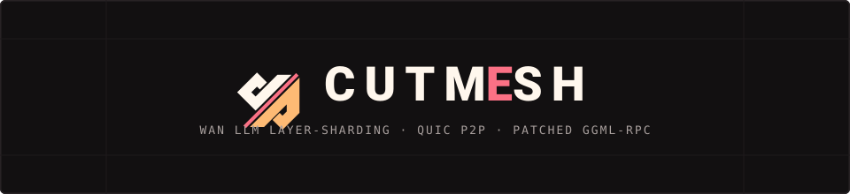
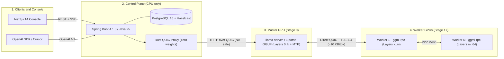
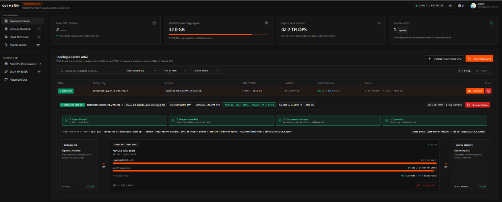

<p align="center">
  
</p>

# Cutmesh

> **Language:** **English** · [Italiano](./README.it.md)

**Cutmesh** is an open-source distributed LLM inference platform that lets you **pool heterogeneous consumer GPUs — even from home over ordinary Internet connections** — to run large open-weight models (`27B–74B+`) and serve them through a single **OpenAI-compatible API** and **Web Console**.

### What It Does (and Why You Can Run It From Home)

- **Works from home, behind ordinary routers:** each GPU joins with a single `docker run` command on Linux or Windows (WSL2). Built-in **QUIC P2P UDP hole-punching** and automatic UPnP/NAT-PMP establish direct encrypted GPU-to-GPU tunnels without datacenter hardware, InfiniBand, NVLink, or manual VPNs.
- **Mix any GPUs you already have:** combine an 8 GB, 12 GB, 16 GB, or 24 GB+ card across your home PC, a friend's workstation, or a cloud VM. Cutmesh slices the model's transformer layers across the available VRAM and treats them as one unified inference **Rig**.
- **Drop-in OpenAI API & Web Console:** once a Rig is online, point any OpenAI-compatible client (Python SDK, IDE coding assistants, Open WebUI, or the built-in **Chat Playground**) to `/v1/chat/completions` with real-time SSE streaming.
- **Hands-off Auto-Pilot & self-healing:** no manual layer math or config files to hand-tune. Cutmesh measures live VRAM, picks valid cut points, elects the best GPU as Stage-0 Master, and automatically rebalances if a home PC is turned off or disconnects.
- **Built-in activation privacy research:** an optional covariant transformation layer lets you experiment with hiding prompts, outputs, and intermediate activations from untrusted remote worker nodes.

The rest of this document explains **how the system is engineered**: its four layers, stack, protocols, experimental inference-engine adaptations, layer-cutting rules, horizontal scaling, and honest limitations — walked through on a reference model (`Qwen 3.8 27B`), with additional models in the final section.

---

## Table of Contents

1. [The Problem](#1-the-problem)
2. [Reference Model: Qwen 3.8 27B](#2-reference-model-qwen-38-27b)
3. [Architecture: Four Layers](#3-architecture-four-layers)
4. [Stack & Modular Design](#4-stack--modular-design)
5. [Protocols](#5-protocols)
6. [Inference Engine Adaptations (Experimental)](#6-inference-engine-adaptations-experimental)
7. [How the Layer Cut Is Decided](#7-how-the-layer-cut-is-decided)
8. [Networking, NAT & Resilience](#8-networking-nat--resilience)
9. [Core Case Study: Decoding & Activation Security](#9-core-case-study-decoding--activation-security)
10. [System Behavior & Bottlenecks](#10-system-behavior--bottlenecks)
11. [Field Tests & Observations](#11-field-tests--observations)
12. [Quick Start](#12-quick-start)

---

## 1. The Problem

### Sometimes the model fits, sometimes it does not

The obvious case is "the weights are too large for one GPU." That is true for 70B+ models, but it is not the only reason to distribute inference.

At 4-bit quantization, a 27B-parameter model's weights (~16.4 GB) fit comfortably inside a 24 GB GPU. What does **not** fit is everything else: the KV cache that grows with conversation length, vision encoders, and the Multi-Token Prediction (MTP) head.

At the full 262,144-token context window, the KV cache of `Qwen 3.8 27B` alone requires roughly **16 GB**. Added to the weights, a single 24 GB GPU runs out of memory; two GPUs handle it cleanly. For larger models, the weights themselves exceed a single card even on short prompts.

There are therefore two distinct reasons to distribute computation: **weights that do not fit**, and **context memory that grows as the user talks**. The same GPU pipeline addresses both — only the cut policy changes.

### The second problem: data privacy on remote GPUs

When computation is distributed across external cards, **the remote GPU receives and processes intermediate hidden states directly in its own memory**.

A common but flawed assumption in distributed inference is:
*"We don't send the user's text to the remote GPU, only floating-point vectors from intermediate layers, so the host cannot read the prompt."*

Research has shown this assumption is **false** on two levels:

1. **In transit:** traditional RPC backends transmit tensors over unencrypted TCP connections.
2. **In memory on the remote GPU:** even with an encrypted transport tunnel, the GPU host still observes intermediate hidden states in VRAM. **Logit-Lens** (*nostalgebraist*, 2020) and **Tuned Lens** (Belrose et al., 2023) demonstrated that residual-stream vectors are already partially aligned with the output vocabulary space — projecting them through the public unembedding matrix recovers tokens with non-trivial accuracy. The authors of **Petals** explicitly note this limitation in their security documentation.

Homomorphic encryption per token is not used here. The approach implemented in [Section 9](#9-text-protection-in-use) applies software transformations from recent literature on computational invariance and covariant obfuscation (*SliceGPT*, *QuaRot*, *AloePri*, *ConjFormer*), whose mathematical guarantees and limits rest entirely with the cited papers.

### The five questions I started from

This project did not start from a product pitch, but from five engineering questions:

1. **Can an LLM actually be sliced across ordinary machines?** Not "into how many pieces," but whether a model built to run monolithically can be cleanly partitioned across heterogeneous GPUs and still serve reliably.
2. **Can intermediate vectors be obfuscated while in use?** Encrypting the wire is not enough if the remote GPU sees plaintext-aligned hidden states in VRAM.
3. **Can it work peer-to-peer across home routers and NAT?** Without a central GPU server holding the weights, with nodes joining and leaving dynamically.
4. **Does the cut need to be adapted per model architecture?** Layers are no longer uniform. The answer this system gives is **yes**: each architecture needs its own declarative policy and adapter.
5. **Can every LLM architecture be adapted this way?** **This question remains open.** Three distinct model families have been tested, which documents working cases rather than a universal law.

The first four are architecture. The fifth remains open.

---

## 2. Reference Model: Qwen 3.8 27B

The key shift in modern LLMs is that **layers are no longer identical**. Dividing a 64-layer hybrid model "32 and 32" is valid structurally, but severely imbalanced in memory and compute.

| Property | Value |
|---|---|
| Backbone layers | 64 — 16 repetitions of **3 Gated DeltaNet + 1 Full Attention** (`full_attention_interval: 4`) |
| Layers allocating KV cache | **Only 16** (full-attention layers: `blk.3`, `7`, `11`, …, `63`) |
| Fixed-state layers | 48 Gated DeltaNet layers holding recurrent state (~1.5 MB/layer in BF16, constant with context length) |
| KV cache footprint | ≈64 KB/token (FP16) → **≈16 GB** at 262,144 tokens |
| Activation vector across cut | 5,120 dims ≈ **10 KB/token** in FP16 |
| Layer weight size (4-bit GGUF) | ≈172 MB (`blk.14`) to ≈269 MB (`blk.63`) — **non-uniform** |
| MTP speculative head | `blk.64`, ~335 MB |
| Vocabulary + LM head | `token_embd.weight` + `output.weight`, ~1.68 GB combined |

Because KV cache concentrates on just 16 layers, a naive 50/50 layer count split creates a severe memory imbalance as conversations grow.

---

## 3. Architecture: Four Layers

The system is strictly separated into four layers. The first two never touch model weights or tensors; all inference computation happens directly between the GPU nodes in layers 3 and 4.



| Layer | Role & Key Details |
|---|---|
| **1 · Clients & Console** | Next.js 14 Console and any OpenAI-compatible client (`POST /v1/chat/completions`, SSE streaming, JWT + Bearer API keys). The only public entry point. |
| **2 · Control Plane (CPU-only)** | Spring Boot 4.1.3 / Java 25 LTS (7 modules) + PostgreSQL 16 + Hazelcast 5.3.8. Tracks live NVML heartbeats (VRAM, bandwidth, power, temp, RTT), runs the water-filling planner, and forwards JSON/SSE via a weightless Rust HTTP-over-QUIC tunnel even when the Master is behind NAT. Never holds weights or sees tensors. |
| **3 · Auto-Elected Master (Stage 0)** | Runs `llama-server` directly on GPU (`Master-on-GPU`), owns the Sparse GGUF, pins `token_embd.weight` + `output.weight` + `blk.64` (MTP) via `-ot`, executes the opening layers, and returns the streamed response. |
| **4 · Worker GPUs (Stage 1+)** | Run `ggml-rpc-server` bound strictly to `127.0.0.1` behind the Rust P2P daemon. Fetch **only** their assigned layers via grouped HTTP Range requests into a local FNV-1a cache. Communicate GPU-to-GPU over direct QUIC v1 + TLS 1.3 (Ed25519 identity + UDP hole-punching, no relay on the tensor path): **≈10 KB/token forward**, single return hop for logits & MTP. |

### Core Concepts: Pool, Rig & Lifecycle

- **Worker Node & Pool Mode:** Each connected GPU registers in `IDLE_STANDBY_POOL` under either **`SHARED_POOL`** (eligible for automatic pairing with other GPUs) or **`PRIVATE_SOLO`** (reserved exclusively for its owner).
- **Rig:** A **logical inference cluster** composed of 1 or more GPUs locked together (`LOCKED_IN_RIG`) to serve one complete model instance (Stage-0 Master + Stage 1..N Workers). Multiple independent Rigs can run in parallel to scale throughput for the same model or serve different models concurrently.
- **Auto-Pilot vs. Manual Mode:** Models configured in **`AUTO_PILOT`** (ordered by priority `P1`–`P5`) automatically form a Rig as soon as enough healthy standby VRAM joins the pool. Models in **`MANUAL_ONLY`** wait for an operator to compose a specific GPU topology.
- **4-Stage Rig State Machine (FSM):**
  1. `LAYERS_ALLOCATED` — The planner computes layer boundaries, `--tensor-split`, unlocked context window (`-c`), and elects the Stage-0 Master.
  2. `PREWARMING_SHARDS` — Each Worker pulls only its assigned GGUF byte ranges into its local FNV-1a cache.
  3. `LOADING_VRAM` — The Master starts `llama-server` (`Master-on-GPU`) and maps weights across Stage 0 and remote `ggml-rpc` peers.
  4. `OPERATIONAL (200 OK)` — The Rig enters the OpenAI `/v1` routing pool with sticky KV-cache affinity (`conversation_id`).

### Automatic Stage-0 Master Election

No GPU is manually hardcoded as the Master. Whenever a Rig is formed (or healed after a node disconnect), the orchestrator **automatically elects the Stage-0 Master** among the candidate GPUs based on:
- **Stage-0 VRAM headroom** (must comfortably host `token_embd`, `output`, `blk.64` MTP, plus the opening backbone layers),
- **Memory bandwidth & compute score** (minimizing sampling and MTP latency),
- **Pairwise RTT proximity** to the remaining workers in the Rig.

If the elected Master drops offline, the Control Plane automatically promotes a healthy surviving GPU as the new Stage-0 Master and re-establishes the HTTP-over-QUIC tunnel — keeping the VPS 100% weightless and zero-load.

### The Sparse GGUF

The Master node maintains a sparse GGUF file with the full virtual size of the model, but physically storing only the GGUF header, `token_embd.weight`, `output.weight`, and Stage 0 layers. Every remote tensor is a zero-byte sparse hole tagged with its content hash. When the engine requests a remote weight, the Worker resolves it from its own local NVMe cache. **No single node has to download the entire model, and zero model bytes traverse the Control Plane.**

### Live Web Console

<p align="center">
  
</p>

---

## 4. Stack & Modular Design

| Component | Stack | Responsibility |
|---|---|---|
| **Data Plane & Node Agent** | **Rust** (`iroh`, `tokio`, `reqwest`) | QUIC P2P transport, Ed25519/TLS 1.3 identity, STUN & UDP hole-punching, TCP↔QUIC RPC bridge, grouped HTTP Range shard puller, per-model `ModelAdapter` trait (`src/models/`), NVML hardware telemetry |
| **Inference Engine & Kernels** | **C++ / CUDA** (patched `llama.cpp`) | `llama-server` + `ggml-rpc-server` with 6 distributed transport/cache/graph/MTP patches, GQA + Gated DeltaNet kernels |
| **Control Plane (7 Modules)** | **Java 25 LTS / Spring Boot 4.1.3 / PostgreSQL 16 / Hazelcast 5.3.8** | Acyclic 7-module Maven layout (`common`, `audit`, `iam`, `fleet`, `orchestration`, `gateway`, `app`) decoupled via DIP ports; multi-pod horizontal scaling with Hazelcast sticky routing & PostgreSQL advisory leader election; paginated 10,000-rig fleet API |
| **Web Console & Playground** | **TypeScript / Next.js 14 / React 18 / Tailwind** | App Router pages (`/overview`, `/catalog`, `/gpus`, `/api-keys`, `/playground`, `/users`, `/audit`), live `nvidia-smi` VRAM telemetry, streaming SSE chat with `<think>` separation, full IT/EN i18n |
| **Model Policies** | Declarative JSON (`models/*/policy.json`) | Per-architecture cut rules (`layer_group_alignment`, MTP pinning, Stage-0 headroom, sampling defaults) |
| **Distribution** | Docker + NVIDIA Container Toolkit | GPU worker container with persistent cache volume (`-v cutmesh-cache:/data/cutmesh`) for Linux & Windows/WSL2 |

---

## 5. Protocols

### Networking & NAT Traversal
- **QUIC v1 over UDP:** replaces TCP between GPUs, eliminating head-of-line blocking and repeated handshakes on every decode step.
- **TLS 1.3 with Ed25519 node identities:** self-authenticating peer IDs derived from each node's public key — no DNS certificates or external CA required.
- **Dedicated ALPN channels:** separate multiplexed protocols on the same QUIC connection for `ggml-rpc` tensor/graph traffic, reverse HTTP proxy (`/v1/chat/completions`), and shard metadata/prewarming.
- **Reverse UDP hole-punching:** discovers public UDP mappings via STUN/QUIC and upgrades connections from relay signaling to direct peer-to-peer links.
- **Resilient session layer:** buffers and realigns interrupted streams if a link or VPN drops mid-generation, avoiding engine crashes.

### Distributed Weights & Compute
- **Sparse GGUF + Hash Translation:** remote tensor placeholders are translated on the fly to the Worker's FNV-1a local tensor cache keys.
- **Grouped HTTP Range Prewarming:** workers read only the GGUF header from Hugging Face / CDN, compute exact byte offsets for their assigned layers, and download only their slice in coalesced byte ranges.
- **Sticky KV-Cache Routing:** the Control Plane routes multi-turn conversations (`conversation_id`) back to the same Rig across pods via Hazelcast + Rendezvous hashing fallback, preserving KV cache warmness.

---

## 6. Inference Engine Adaptations (Experimental)

Upstream `llama.cpp`'s RPC backend was designed for LAN-connected GPUs with a full local GGUF on the coordinator. Over WAN links with a sparse Master GGUF, six **experimental, workload-specific** adaptations were applied (`scripts/patch_ggml_rpc.py`):

| Upstream Behavior | WAN / Sparse GGUF Impact | Adaptation |
|---|---|---|
| Worker tensor cache queried only for large weights (>10 MB) | Small tensors would be pushed from Master, which holds sparse holes | Lowered cache threshold (`64 KB`): all layer tensors resolve from the Worker's local cache |
| Computation graph keyed by a counter that changes between prefill & decode | Entire compute graph re-transmitted on every phase switch | Content-addressed graph hashing: identical topologies reuse cached graphs |
| Individual commands trigger multiple synchronous writes + ACKs | High RTT penalty repeated on every token | Coalesced stage TX batches and asynchronous `SET_TENSOR` activation dispatch |
| Buffer allocation sizes queried synchronously over RPC per GPU | Extra WAN round-trips whenever prompt length changes | Exact CUDA allocation alignment computed locally on the Master |
| Layer device placement ignores per-tensor overrides | Auxiliary MTP head buffers land on remote nodes, away from embeddings | Device placement respects `-ot` tensor overrides so `token_embd`, `output`, and MTP stay pinned on Stage 0 |
| Pipeline parallelism disabled when `-ot` overrides are active | Pinning and pipeline parallelism appeared mutually exclusive | Constraint lifted so Stage-0 pinning and pipeline parallelism coexist |

These are transport and scheduling adaptations to the inference engine — they do not modify model weights or numerical outputs.

---

## 7. How the Layer Cut Is Decided

- **Layers are non-uniform:** `blk.14` (≈172 MB) and `blk.63` (≈269 MB) differ significantly, and only 16 of 64 layers hold KV cache. Rules live in declarative `policy.json` profiles and per-model Rust `ModelAdapter` implementations rather than hardcoded assumptions.
- **Coupled tensors stay together:** `blk.64` (MTP) shares `token_embd.weight` and `output.weight`, so all three are pinned on the Stage-0 Master via `-ot`.
- **Decode speed vs. context length pull in opposite directions:** decode is memory-bandwidth bound (favoring larger weight slices on faster-bandwidth cards), whereas full 262k context requires spreading the 16 attention layers so KV cache does not overflow a single GPU.

> **Why every model must be analyzed before cutting:** You cannot safely slice an arbitrary LLM blind. Before a model is admitted, its GGUF header and layer graph must be inspected to determine exact per-layer weight sizes, which layer indices allocate KV cache vs. fixed recurrent state, and which auxiliary tensors (embeddings, LM head, MTP/drafter) must stay co-located. A blind uniform split either triggers OOM on whichever GPU inherits too many attention layers, breaks speculative heads, or leaves faster GPUs starved. That upfront architectural analysis is what gets codified into each model's `policy.json` and Rust `ModelAdapter`.

---

## 8. Networking, NAT & Resilience

- `ggml-rpc-server` binds strictly to `127.0.0.1` and is **never exposed directly on the network** — all tensor traffic travels inside the Ed25519-authenticated QUIC tunnel.
- RTT-aware peer grouping keeps pipeline hops on low-latency links whenever possible.
- Continuous NVML heartbeats + automatic watchdog restarts handle transient GPU/RPC faults; disconnected nodes trigger rig healing.

---

## 9. Core Case Study: Decoding & Activation Security

> [!IMPORTANT]
> **Why this matters:** In distributed LLM inference, encrypting the network tunnel (QUIC / TLS 1.3) only protects data *in transit* — **not data in use inside the remote GPU's VRAM**. Decoding security on untrusted worker nodes is one of the central research case studies of Cutmesh.

As demonstrated by **Logit-Lens** (*nostalgebraist*, 2020) and **Tuned Lens** (Belrose et al., 2023), intermediate residual-stream hidden states stay partially aligned with the model's public unembedding matrix, allowing a remote GPU host to reconstruct prompt and completion tokens directly from activations.

Cutmesh explores software-level **covariant activation obfuscation** and **runtime integrity verification** directly grounded in published literature (without claiming new cryptographic proofs):
- **SliceGPT** (Ashkboos et al., ICLR 2024 — [arXiv:2401.15024](https://arxiv.org/abs/2401.15024)): orthogonal basis rotation absorbed into neighboring weights under RMSNorm.
- **QuaRot** (Ashkboos et al., NeurIPS 2024 — [arXiv:2404.00456](https://arxiv.org/abs/2404.00456)): practical Hadamard rotations in the forward pass.
- **AloePri** (Lin et al., 2026 — [arXiv:2603.01499](https://arxiv.org/abs/2603.01499)): session-seeded vocabulary permutation + invertible transforms (<5% token recovery under strong attacks).
- **ConjFormer** (Yukhimchuk et al., 2026 — [arXiv:2606.16461](https://arxiv.org/abs/2606.16461)): formal analysis of equivariance conditions and weight-alignment limits.
- **Petals** (Borzunov et al., ACL 2023 — [ACL 2023](https://aclanthology.org/2023.acl-demo.54/)): collaborative Internet inference and documented activation privacy limits.

As the authors of *AloePri* and *ConjFormer* themselves emphasize, these transformations are **obfuscation, not formal cryptography** (colluding nodes or weight-alignment attacks remain open theoretical limits). Cutmesh ships a built-in verification suite (`audit-covariant`) running Logit-Lens and Procrustes alignment tests alongside runtime canary probes to detect tampered worker outputs.

---

## 10. System Behavior & Bottlenecks

| | Decode (token generation) | Prefill (prompt ingestion) |
|---|---|---|
| Data crossing each cut | 1 vector ≈ **10 KB/token** | 1 vector per prompt token (512 tok ≈ 5 MB) |
| Long prompt impact | Still 10 KB/token | Scales linearly with prompt length |
| Primary bottleneck | VRAM memory bandwidth + WAN RTT | Compute + activation transfer |
| Effect of adding GPUs | Unlocks larger models & longer context; throughput scales with concurrent requests | Pipeline stage latencies add up on single requests |

Over WAN, **network latency matters more than raw aggregate TFLOPS** for single-stream decode — the opposite of datacenter tensor parallelism.

---

## 11. Field Tests & Observations

Tests were executed on heterogeneous rented GPUs across **Vast.ai** (different countries, consumer and workstation cards from 8 GB to 96 GB VRAM, NAT/VPN links):

- **Latency dominates raw TFLOPS:** cross-ocean links (≈160 ms RTT) dropped single-stream decode to ≈2 tok/s; co-located low-RTT peers scaled ≈8× higher, reaching ≈29 tok/s with RTT-aware grouping and partial shard caching.
- **Model-specific policies are mandatory:** `Qwen 3.8 27B` is the primary validated model; `Nemotron 3.5 Bolt 74B` and `GLM-5.3-Flash` (6-shard `UD-Q4_K_XL` across ≈240 GB VRAM) are currently **under evaluation** and each requires its own cutting profile.
- **Partial HTTP Range downloads cut cold-start transfer by ~40%**, and persistent cache volumes make subsequent startups near-instant.
- **Master-on-GPU single & multi-GPU rigs:** verified `Qwen 3.8 27B` serving live across 16 GB + 8 GB and 24 GB+ GPU configurations with zero Control Plane GPU/CPU inference load.
- **Horizontal Control Plane scaling:** verified live 2-pod Spring Boot 4.1.3 + Java 25 LTS + Hazelcast 5.3.8 cluster (`Members {size:2}`) sharing sticky routing and advisory leader election against PostgreSQL 16.

---

## 12. Quick Start

### 1. Full Stack via Docker Compose

```bash
cp .env.example .env
# Set POSTGRES_PASSWORD, CUTMESH_JWT_SECRET, and CUTMESH_ADMIN_PASSWORD in .env
docker compose up -d --build
```

- **Web Console:** `http://localhost:30300`
- **Control Plane API & OpenAI Gateway (`/v1`):** `http://localhost:30885`

### 2. Connecting a GPU Worker (Docker)

Generate an enrollment token in **GPU Nodes & Onboarding** (`/gpus`) and run the pre-filled command with persistent weight cache:

```bash
docker run -d --gpus all --restart unless-stopped --name cutmesh-gpu-01 \
  -p 40000:40000/udp \
  -v cutmesh-cache:/data/cutmesh \
  -e CUTMESH_QUIC_PORT=40000 \
  -e CUTMESH_HUB_URL="http://<CONTROL_PLANE_HOST>:30885" \
  -e CUTMESH_NODE_TOKEN="<ENROLLMENT_TOKEN>" \
  -e CUTMESH_NODE_NAME="cutmesh-gpu-01" \
  -e CUTMESH_POOL_MODE="SHARED_POOL" \
  -e CUTMESH_POWER_PCT=100 \
  -e CUTMESH_STRICT_DIRECT=1 \
  ghcr.io/massimolauri/cutmesh-worker:latest
```

### 3. Local Development (3 Components)

**Rust P2P Engine & Worker**
```bash
cargo test
cargo build --release --bin cutmesh

# Run built-in covariant obfuscation & canary verification audit
./target/release/cutmesh audit-covariant --model qwen3.8-27b --dim 256 --vocab-size 1024
```

**Control Plane (Java 25 LTS / Spring Boot 4 / Maven 3.9+)**
```bash
mvn -f control-plane/pom.xml test
POSTGRES_PASSWORD=your_db_password \
CUTMESH_JWT_SECRET=your_32plus_char_jwt_secret \
CUTMESH_ADMIN_PASSWORD=your_initial_admin_password \
mvn -f control-plane/pom.xml -pl cutmesh-app spring-boot:run
```

**Web Dashboard (Node 20+)**
```bash
cd web-dashboard
npm ci
npm run dev
```

---

**Author & License.** Created by **Massimo Lauri** (`Copyright (c) 2026 Massimo Lauri`). Source code is released under the **GNU Affero General Public License v3.0 (AGPL-3.0)** (see [`LICENSE`](./LICENSE)); documentation and technical articles under **CC BY 4.0**.
